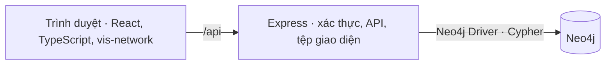

# CourseGraph

**Ứng dụng quản lý môn học và khám phá quan hệ tiên quyết bằng Neo4j.**

CourseGraph là đồ án NoSQL mô hình hóa dữ liệu đào tạo dưới dạng đồ thị. Ứng dụng giúp người dùng tra cứu danh mục, xem chuỗi môn tiên quyết và kiểm tra một sinh viên đã đáp ứng điều kiện để học môn nào.

[Mở bản demo](https://coursegraph-rmls.onrender.com/) · [Cài đặt](docs/setup.md) · [Mô hình dữ liệu](database/schema.md) · [Tài liệu API](docs/api.md)

Bản demo chạy trên Render và sử dụng Neo4j AuraDB. Đăng nhập bằng tài khoản được cấp để khám phá dữ liệu mẫu.

## Tính năng

| Tính năng | Thao tác trên ứng dụng |
| --- | --- |
| **Tra cứu dữ liệu đào tạo** | Tìm kiếm và xem chi tiết môn học, sinh viên, giảng viên, khoa, học kỳ và chương trình đào tạo. |
| **Khám phá đồ thị** | Mở mạng lưới theo môn học hoặc sinh viên, xem chi tiết từng nút và tìm đường đi ngắn nhất giữa hai môn. |
| **Gợi ý môn học** | Xem môn đủ hoặc chưa đủ điều kiện dựa trên các môn tiên quyết trực tiếp và gián tiếp. Có thể lọc theo chương trình đào tạo và học kỳ. |
| **Quản trị dữ liệu** | Thêm, sửa, xóa bản ghi và quan hệ. Hệ thống kiểm tra và từ chối cạnh tạo chu trình tiên quyết. |
| **Nhập và xuất dữ liệu** | Xem trước khi xác nhận nhập JSON hoặc bộ bảy tệp CSV. Xuất toàn bộ dữ liệu nghiệp vụ dưới dạng JSON hoặc xuất từng danh mục và quan hệ dưới dạng CSV. |

`VIEWER` có quyền tra cứu. `ADMIN` có thêm quyền chỉnh sửa dữ liệu, nhập/xuất tệp và quản lý tài khoản.

## Mô hình dữ liệu

Bộ dữ liệu nghiệp vụ sau chuẩn hóa có **210 nút** thuộc **6 loại thực thể** và **1.568 quan hệ** thuộc **12 loại**.

`(MonHoc A)-[:TIEN_QUYET_CHO]->(MonHoc B)` nghĩa là sinh viên cần hoàn thành môn A trước khi học môn B. Các truy vấn Cypher mẫu bao gồm thống kê, tìm chuỗi tiên quyết và tra cứu dữ liệu đào tạo. [Schema](database/schema.md) · [Truy vấn mẫu](database/queries)

## Kiến trúc



| Thư mục | Nội dung |
| --- | --- |
| [`apps/web/`](apps/web) | Giao diện React và đồ thị tương tác, build bằng Vite. |
| [`apps/api/`](apps/api) | API Express, xác thực và nghiệp vụ đồ thị. |
| [`packages/shared/`](packages/shared) | Định nghĩa danh mục và logic xử lý dữ liệu dùng chung. |
| [`database/`](database) | Schema, ràng buộc và truy vấn Cypher. |
| [`scripts/`](scripts) · [`infra/`](infra) | Công cụ nhập liệu, vận hành local và cấu hình container. |

## Chạy trên Windows

**Chuẩn bị** Node.js 24, PowerShell và Neo4j Desktop có sẵn Neo4j `2026.09.0` cùng Java 21 trong cache. Để nạp đủ dữ liệu, đặt bộ bảy tệp CSV của đồ án vào thư mục `CSV/` ở gốc repo. Bộ CSV gốc được giữ bên ngoài repo công khai.

```powershell
git clone https://github.com/HoaiNam2k5/CourseGraph.git
cd CourseGraph
npm ci
npm run setup:env
powershell -ExecutionPolicy Bypass -File scripts/setup-neo4j.ps1 -Start
npm run data:audit
npm run data:normalize
npm run data:import
npm run data:verify
npm run admin:create
npm run build
powershell -ExecutionPolicy Bypass -File scripts/start-local.ps1 -Background
```

Mở [CourseGraph trên máy](http://127.0.0.1:3000/) và đăng nhập bằng `ADMIN_USERNAME` và `ADMIN_PASSWORD` trong `.env`. Script tạo tài khoản giữ nguyên mật khẩu nếu tài khoản đã tồn tại. Neo4j local dùng database `coursegraph`, cổng HTTP `17474` và cổng Bolt `17687`. [Hướng dẫn cài đặt và xử lý lỗi](docs/setup.md)

## Kiểm thử

| Lệnh | Phạm vi |
| --- | --- |
| `npm run typecheck` và `npm run lint` | Kiểm tra kiểu TypeScript và quy tắc mã nguồn. |
| `npm test` | Kiểm thử đơn vị. |
| `npm run test:integration` | Kiểm thử API với Neo4j trên database riêng `coursegraph-test`. |
| `npm run queries:verify` | Kiểm chứng truy vấn Cypher trên dữ liệu đã nạp. |
| `npm run test:e2e` | Kiểm thử luồng người dùng trên trình duyệt bằng Playwright. |

## Triển khai và demo

[Bản cấu hình Render](render.yaml) chạy React và Express trong một Docker Web Service, kết nối với Neo4j AuraDB. Quy trình triển khai gồm chuẩn bị dữ liệu demo, tạo tài khoản quản trị và cấu hình biến môi trường trên Render. Endpoint `/api/health/ready` kiểm tra kết nối tới database. [Hướng dẫn triển khai](docs/setup.md#6-chuẩn-bị-chạy-với-neo4j-aura-và-render)

Giữ tệp `.env`, CSV gốc và bản sao lưu chứa dữ liệu nội bộ bên ngoài Git.

- [Kịch bản demo đồ án](docs/demo.md)
- [Hướng dẫn khám phá dữ liệu với Neo4j Bloom](docs/bloom-demo.md)
- [Vận hành, sao lưu và khôi phục](docs/operations.md)
